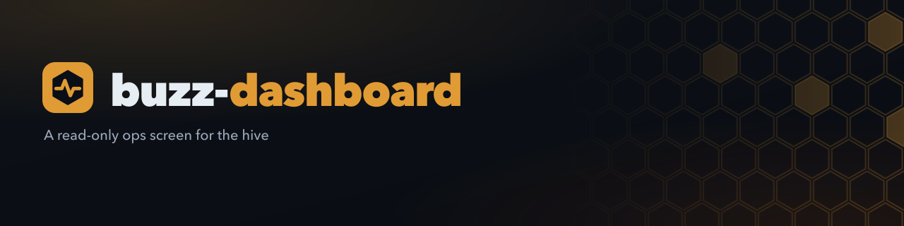

<!-- brand-kit:banner:start -->
<picture>
  <source media="(max-width: 640px)" srcset="./brand/banner-mobile.png">
  
</picture>
<!-- brand-kit:banner:end -->

# buzz-dashboard

A private, read-only dashboard for the Buzz hive: the GitHub `ai-*` pipeline,
agent activity on the Buzz relay, and release health. It never posts, labels,
merges or releases.

Stack: Next.js (App Router) + TypeScript + Tailwind + shadcn/ui, built as a
`standalone` server for a single Docker image.

## Develop

```sh
cp .env.example .env.local   # fill in the read-only credentials
pnpm install
pnpm dev                     # http://localhost:3000
```

## Checks

```sh
pnpm lint        # Biome
pnpm typecheck   # tsc
pnpm test        # Vitest
pnpm build       # next build (standalone output)
```

CI runs all four on every PR and push to `main`.

## Configuration

All configuration is environment-only and read on the server. Tokens never
reach the browser. See [`.env.example`](.env.example).

| Variable | Purpose |
|---|---|
| `GITHUB_TOKEN` | Optional fine-grained, read-only GitHub token for the `GITHUB_OWNERS` repos. Without it the GitHub-backed views show "source down" |
| `GITHUB_OWNERS` | Comma list of GitHub users or orgs to read, e.g. `octo-org,octo-labs`. No default: without it the GitHub-backed views show "source down" |
| `GITHUB_TRUSTED_AUTHORS` | Comma list of logins whose 🤖 header names an agent, e.g. `octo-bot,octocat`. Unset trusts nobody, so everything shows as unattributed |
| `BUZZ_RELAY_URL` | Buzz relay URL |
| `BUZZ_PRIVATE_KEY` | Hex key of a dedicated read-only Buzz identity |
| `BUZZ_AUTH_TAG` | Optional NIP-OA owner attestation JSON, needed if that identity is not a relay member |
| `MEDIA_BASE_URL` | Public https URL of the media bucket, e.g. `https://media.torcato.dev` |
| `R2_ACCOUNT_ID`, `R2_BUCKET` | Cloudflare account ID and R2 bucket name behind `MEDIA_BASE_URL` |
| `R2_ACCESS_KEY_ID`, `R2_SECRET_ACCESS_KEY` | S3 credentials of an R2 API token with Object Read only on that bucket |
| `BUZZ_OWNER_PUBKEY` | Hex pubkey of the agents' owner. Only profiles with a valid NIP-OA attestation from this key count as agents. Defaults to the owner in `BUZZ_AUTH_TAG`; one of the two must be set |
| `AGENT_ALIASES` | Optional JSON of renamed agents, former → current display name, e.g. `{"Fizz":"Prime"}`. An old profile folds into the current name and `/agents/<old-name>` redirects |
| `NEEDS_YOU_EXCLUDE_LABELS` | Optional comma list of labels to leave off the Needs-you card. Set it to `merge-ready` when a merge bot handles those PRs |

There is no auth system. Put the dashboard behind your network layer
(Tailscale or Cloudflare Access).

## Run locally in Docker

```sh
./scripts/docker-dev.sh         # build and start, then open http://localhost:3000
./scripts/docker-dev.sh logs    # follow the container logs
./scripts/docker-dev.sh down    # stop the container
```

The first run copies `.env.example` to `.env` and stops so you can fill in the
credentials. Run `git pull` first to pick up new merges; each start rebuilds
the image.

## Run on the homelab

The `Dockerfile` is multi-stage and the final image holds only the Next.js
standalone server. It runs as the non-root `node` user.

```sh
cp .env.example .env    # fill in the read-only credentials
docker compose up -d --build
```

Compose binds port 3000 to `127.0.0.1` only, so nothing is exposed until you
publish it through one of these:

**Tailscale** (tailnet-only access):

```sh
tailscale serve --bg 3000   # https://<host>.<tailnet>.ts.net
```

Restrict who can reach the host with your tailnet ACLs.

**Cloudflare Access** (public hostname behind SSO):

1. Create a tunnel: `cloudflared tunnel create buzz-dashboard`, then route a
   hostname to `http://localhost:3000`.
2. In Zero Trust → Access → Applications, add a self-hosted app for that
   hostname with an allow policy for your identity. Do this before the tunnel
   goes live, because the dashboard has no login of its own.

## Run the published image behind a reverse proxy

The `Publish image` workflow pushes `ghcr.io/rtorcato/buzz-dashboard` for
`linux/amd64`:

| Tag | When |
|---|---|
| `sha-<short>` | Every push to `main` |
| `vX.Y.Z` | Every semver `v*` tag, including prereleases like `v1.0.0-rc.1` |
| `latest` | Every non-prerelease semver `v*` tag |

Pin a `sha-` or `vX.Y.Z` tag on the host so an upgrade is always a deliberate
edit. If the package is private, run
`docker login ghcr.io -u <user>` on the host first, using a token with only
`read:packages`.

Let the proxy reach the container over a shared Docker network instead of
publishing a host port. For example, with Traefik on an external `proxy`
network:

```yaml
services:
  dashboard:
    image: ghcr.io/rtorcato/buzz-dashboard:sha-abc1234
    restart: unless-stopped
    env_file: .env
    cap_drop: [ALL]
    security_opt: ["no-new-privileges:true"]
    networks: [proxy]
    labels:
      - traefik.enable=true
      - traefik.http.routers.buzz-dashboard.rule=Host(`dashboard.example.com`)
      - traefik.http.routers.buzz-dashboard.entrypoints=websecure
      - traefik.http.routers.buzz-dashboard.tls=true
      # The dashboard has no login. Attach your auth middleware here.
      - traefik.http.routers.buzz-dashboard.middlewares=<your-auth>@file
      - traefik.http.services.buzz-dashboard.loadbalancer.server.port=3000

networks:
  proxy:
    external: true
```

Keep access control in front of the dashboard (an SSO or forward-auth
middleware, an IP allowlist, or a VPN-only entrypoint) before you route a
hostname to it. The container listens on port 3000 and terminates no TLS.

## Alternatives

[assafshafran/buzz-agent-fleet](https://github.com/assafshafran/buzz-agent-fleet) runs Buzz agents as systemd services on a VPS and ships a small Python portal that can also manage agents (create/edit/start/stop) and show a live tool-activity feed. buzz-dashboard is read-only by design.
